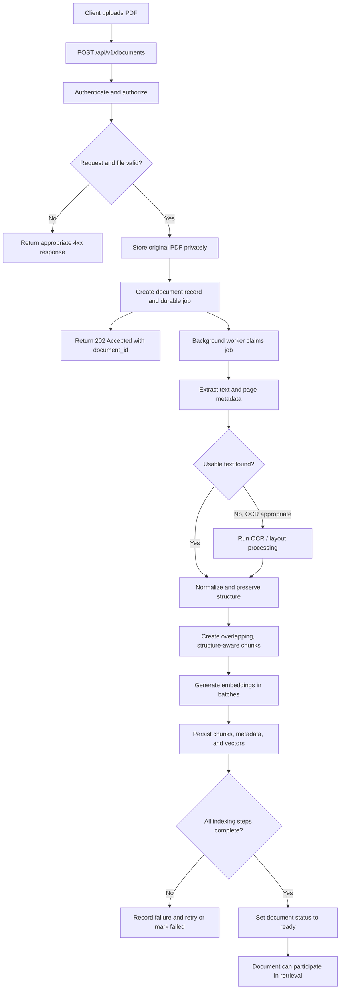

# Compliance & Document Intelligence Engine
## Functional Requirements Specification (FRS)

---

## 1. Executive Summary & Purpose

**DocuMind-AI** is an automated compliance and document intelligence microservice designed to process dense, complex documents (e.g., contracts, utility agreements, administrative policies) and answer specific operational or legal questions.

### What is DocuMind-AI?
The name **DocuMind-AI** reflects the core philosophy of giving passive, static PDF files a "mind" or brain of their own. Instead of sitting idle in a folder, documents become interactive and intelligent—capable of understanding their own clauses, cross-referencing concepts, and remembering where every paragraph lives.

Unlike standard text search tools or generic chatbots, DocuMind-AI scans across single or multiple documents simultaneously, extracts precise answers based on conceptual meaning, and provides direct page and section citations for 100% human verifiability.

---

## 2. Core Target Problem & Business Value
* **Problem:** Users spend hours manually reading through multi-page, dense PDFs (such as German rental contracts or utility annexes) to locate critical operational rules, clause details, or cancellation terms.
* **Solution:** An automated backend engine that ingests multi-document packages, retrieves contextual information dynamically, and outputs structured, cited answers.
* **Key Differentiator:** The system prioritizes **data accuracy and privacy (GDPR-focused design)** by strictly grounding its answers in the provided text and eliminating unverified responses.

---

## 3. Detailed Functional Scope

### 3.1 Document Ingestion & Processing
* **Multi-PDF Support:** The system must accept single or multiple PDF documents uploaded in a single package/session (e.g., a primary lease agreement + secondary utility annex).
* **Structural Preservation:** System reading must maintain document layout context, including page numbers, section headers, and paragraph boundaries.
* **Conceptual Indexing:** The system must index content based on underlying meaning (semantic context) rather than exact keyword matches alone.

### 3.2 Dynamic Cross-Document Retrieval
* **Multi-File Scanning:** When a user queries the system, it must scan across all uploaded files relevant to the session, not just a single active file.
* **Targeted Context Extraction:** The engine must identify and pull only the specific sections or paragraphs that directly address the user's intent.

### 3.3 Reasoning & Output Generation
* **Plain Language Answers:** Synthesizes extracted text segments into a clear, direct answer addressing the user's query.
* **Strict Source Citations:** Every generated answer must include exact locations for verification:
  * File name / Source document
  * Page number(s)
  * Section / Clause header (where applicable)
* **Strict Safety Guardrails ("No Hallucination" Rule):** If a query cannot be answered using the uploaded documents, the system must explicitly return a *"Not found in source"* status rather than attempting to guess or invent information.

---

## 4. End-User Journey Example

### Scenario: Alex Renting a Flat in Germany
1. **Upload Phase:** Alex uploads two complex PDFs to the microservice:
   * `rental_agreement.pdf` (25-page main contract)
   * `utility_annex_flat_b.pdf` (5-page supplementary cost breakdown)
2. **Query Phase:** Alex submits two queries:
   * *Query 1:* "Are heating and electricity costs included in my monthly rent?"
   * *Query 2:* "What is the notice period and procedure if I need to exit the contract early?"
3. **Execution Phase:**
   * The system scans `utility_annex_flat_b.pdf` to resolve Query 1.
   * The system scans `rental_agreement.pdf` (Section 12) to resolve Query 2.
4. **Result Delivery:** The system outputs structured JSON containing the direct answers, confidence levels, and precise page/section pointers for Alex to double-check directly in his files.

---

## 5. Output Specification (Functional Structure)

The system must output responses in a structured schema containing the following fields:

| Field Name | Description | Example |
| :--- | :--- | :--- |
| `answer` | Synthesized answer to the query | "Heating is included up to €150/month. Electricity is billed separately." |
| `status` | Query resolution status | `SUCCESS` \| `NOT_FOUND` \| `AMBIGUOUS` |
| `citations` | Array of source locations | `[{ file: "utility_annex_flat_b.pdf", page: 3, section: "Clause 4.1" }]` |
| `confidence_score` | System certainty metric | `0.95` |

---

## 6. Project Roadmap & Change Log
* **[2026-10-25] - Version 0.1:** Document created with core functional requirements, user story (Alex's rental scenario), citation specs, and guardrails.

# 7. Upload Endpoint Functionality in Detail

Let's open up the hood and follow what happens inside the backend when Alex uploads `utility_annex.pdf`.

Since we already have experience with traditional backend development, and relational databases, most of this workflow will feel familiar. The new pieces are the document-processing pipeline, text chunking, **embedding generation**, and vector search preparation.

The key idea is that **uploading a file and making its contents searchable are two different operations**. The upload endpoint accepts and securely stores the original file. A processing pipeline then extracts its content, prepares chunks, generates embeddings, and persists the results so that the document can later be used in retrieval-augmented generation (RAG).

This distinction matters because PDF parsing and embedding generation can take seconds or longer, may call external services, and can fail independently of the HTTP request. A robust design therefore separates the initial upload from the heavier processing work.

## 7.1 The End-to-End Lifecycle at a Glance

A typical production flow looks like this:

1. The client sends a multipart HTTP request containing the PDF and any required metadata.
2. The API authenticates the caller and authorizes the requested operation.
3. The API validates the file, request metadata, and upload limits.
4. The original PDF is written to private file or object storage, and a document record is created.
5. A background job is queued to process the document.
6. A worker extracts text and page-level metadata from the PDF, using OCR when required.
7. The worker divides the extracted content into retrieval-friendly chunks.
8. The embedding model converts each chunk into a numeric vector.
9. The text chunks, metadata, and vectors are saved to PostgreSQL, with `pgvector` used for vector similarity search.
10. The document status is updated so the client can tell whether the document is ready to search.

The API should not report the document as *ready* merely because it has accepted the PDF. Acceptance means the source file has been received; readiness means the processing and indexing steps have completed successfully.

## 7.2 Step 1: Receiving the HTTP Request

The frontend or an API client sends an HTTP `POST` request to an endpoint such as:

```http
POST /api/v1/documents
Authorization: Bearer <access_token>
Content-Type: multipart/form-data
```

The multipart body might contain:

- `file`: the PDF binary data.
- `document_type`: a document category, if the application requires one.
- `title`: an optional user-facing title.
- Other explicitly supported metadata fields, such as a project or workspace ID.

A simplified request from a browser might look like this:

```javascript
const formData = new FormData();
formData.append("file", selectedFile);
formData.append("document_type", "utility_annex");

const response = await fetch("/api/v1/documents", {
  method: "POST",
  headers: {
    Authorization: `Bearer ${accessToken}`
  },
  body: formData
});
```

When sending `FormData` from a browser, do not manually set the multipart `Content-Type` header. The browser must add the appropriate boundary parameter.

### 7.2.1 Authentication and authorization

Authentication answers **who is making the request?** Authorization answers **is that user allowed to perform this operation in this workspace or tenant?** They are related, but not interchangeable.

The API typically:

1. Verifies the access token's signature and required claims, including its issuer, audience, and expiration.
2. Obtains the authenticated user's stable identifier, such as `user_id`.
3. Checks relevant permissions, such as whether the user may upload documents to the selected workspace.
4. Uses the authenticated identity, rather than a user ID supplied in the request body, to establish ownership.

If the token is missing or invalid, the API should return `401 Unauthorized`. If the caller is authenticated but lacks the required permission, it should return `403 Forbidden`, or an appropriate non-disclosing response when the application must avoid revealing whether a resource exists.

### 7.2.2 Request and file validation

Before accepting the file, validate both the request metadata and the file itself. Typical checks include:

- A file was actually included.
- The file size is within the configured limit.
- The extension and declared MIME type are consistent with the expected format.
- The file's binary signature and parser result are consistent with a valid PDF.
- Required metadata is present and uses an allowed value.
- The user has not exceeded any upload quota or rate limit.
- The file does not violate the application's security policy.

Do not trust the filename or `Content-Type` header by itself. Both are supplied by the client and can be misleading. A file named `report.pdf` is not necessarily a PDF.

Depending on the threat model, the service may also run malware scanning and reject encrypted, corrupted, password-protected, or unusually complex PDFs. PDF parsers should be kept up to date and run with appropriate resource limits because uploaded files are untrusted input.

### 7.2.3 Immediate responses

For a background-processing design, the endpoint commonly returns `202 Accepted` after the file has been safely persisted and a processing job has been recorded or queued.

Example response:

```json
{
  "document_id": "doc_8f31a2",
  "status": "queued",
  "filename": "utility_annex.pdf",
  "status_url": "/api/v1/documents/doc_8f31a2"
}
```

The exact ID and response shape depend on the application's API contract. The important point is that the response clearly distinguishes an accepted upload from a document that is already indexed and searchable.

For invalid input, the API can return `400 Bad Request` or `422 Unprocessable Content`. Use `413 Content Too Large` when the upload exceeds the configured size limit, `415 Unsupported Media Type` for an unsupported format, and `429 Too Many Requests` when a rate limit is exceeded. A generic `500 Internal Server Error` should not expose internal paths, stack traces, tokens, or implementation details.

## 7.3 Step 2: Persisting the Original File Safely

Once the request passes validation, the service needs a durable copy of the source document. The file might be streamed to private object storage, such as an S3-compatible store, or to a protected filesystem. For larger systems, object storage is usually easier to scale than storing large binary files directly in application tables.

A common design stores:

- **The original PDF** in private file/object storage.
- **Document metadata** in PostgreSQL.
- **A processing job** in a queue or durable job table.

The `documents` row can contain the owner, original filename, storage key, upload timestamp, processing status, and extracted document properties. It should not need to contain the entire PDF binary if the application uses object storage.

### 7.3.1 Why store the source PDF separately?

Keeping the original file allows the system to reprocess it when the extraction logic, chunking policy, embedding model, or index format changes. It also supports downloads, audits, and troubleshooting, subject to the application's retention and privacy rules.

Store files under an internal generated key rather than directly trusting a client-supplied path or filename. Keep the bucket or storage container private, and use short-lived authorized download links if users need direct access. Apply encryption, access controls, retention policies, and deletion rules appropriate to the data.

### 7.3.2 Avoiding partial uploads and duplicate records

Database and object storage operations generally do not share a single transaction. For example, the PDF could be written successfully while the database insert fails, leaving an orphaned object. Conversely, the database row could be created while the upload fails.

Handle this deliberately:

- Use a clear upload state or a temporary storage key until the upload is complete.
- Clean up temporary objects when a database or queue operation fails.
- Run a periodic reconciliation job for orphaned files and stale records.
- Consider an idempotency key so a retried client request does not create duplicate documents.
- Use a transactional outbox or another durable job-publication pattern if losing the processing event between the database commit and queue publication would be unacceptable.

The correct solution depends on the infrastructure. The principle is to make incomplete states visible and recoverable rather than assuming every step will succeed together.

## 7.4 Step 3: Starting the Processing Pipeline

After the original file and its document record are persisted, the system schedules background processing. The endpoint should generally avoid parsing a large PDF and generating every embedding before returning its HTTP response.

A processing job may contain a small payload such as:

```json
{
  "document_id": "doc_8f31a2",
  "operation": "process_document"
}
```

The worker retrieves the document record and source file using the internal document ID. It then performs extraction, chunking, embedding generation, and indexing.

### 7.4.1 Why use a background worker?

This design has several advantages:

- The HTTP request is less likely to time out while parsing or embedding a large document.
- Workers can scale independently from the API servers.
- Failed jobs can be retried under controlled conditions.
- Expensive embedding calls can be rate-limited and batched.
- The API remains responsive while multiple documents are being processed.

A simple implementation may run processing inline for small documents or prototypes. For a production system, asynchronous processing is usually the more resilient default.

### 7.4.2 Model the document status explicitly

A practical status lifecycle could be:

`uploaded` → `queued` → `processing` → `ready`

Failure and recovery states might include `failed`, `retrying`, or `deleting`. Choose a small, well-defined set of states and document what each one means. Store error details suitable for support and monitoring, but avoid exposing raw stack traces to the client.

The status endpoint can let the frontend poll for updates:

```http
GET /api/v1/documents/doc_8f31a2
```

Example response:

```json
{
  "document_id": "doc_8f31a2",
  "status": "processing",
  "progress": {
    "stage": "embedding",
    "completed_chunks": 18,
    "total_chunks": 42
  }
}
```

Progress reporting is optional. If shown, it should be based on real worker state rather than an estimated percentage that may be inaccurate.

## 7.5 Step 4: Extracting Text from the PDF

A PDF is a page-description format, not a clean document database. It can contain positioned text, fonts, images, tables, annotations, and other drawing instructions. Consequently, extracting its content is not always as simple as reading one continuous string.

The worker downloads or opens the source PDF and passes it to a suitable PDF parsing library. The extractor should aim to retain useful structure, including:

- Page number.
- Extracted text for each page.
- Reading order where the library can infer it.
- Bounding boxes or layout coordinates when needed.
- Section or heading information when it can be detected reliably.
- Extraction warnings, such as pages with no usable text.

For example, the parser might produce an internal representation like:

```json
{
  "document_id": "doc_8f31a2",
  "pages": [
    {
      "page_number": 1,
      "text": "Utility Annex...",
      "extraction_method": "text"
    },
    {
      "page_number": 2,
      "text": "Section 2: Service Conditions...",
      "extraction_method": "text"
    }
  ]
}
```

This is illustrative, not a required storage format. The exact representation depends on the parser and the information needed by downstream retrieval.

### 7.5.1 Text-based PDFs versus scanned PDFs

There are two common cases:

**Text-based PDF:** The file contains a text layer. A parser can extract characters directly, although column layout, tables, footnotes, headers, and reading order may still need cleanup.

**Scanned or image-only PDF:** Each page is essentially an image. A normal text extractor may return empty or nearly empty text. The pipeline needs optical character recognition (OCR) to recognize text from page images.

A robust pipeline can detect pages with insufficient extracted text and route only those pages through OCR. OCR introduces additional processing time and can produce recognition errors, so it is helpful to retain extraction provenance and warnings. For complex tables, forms, or multi-column layouts, a layout-aware extractor may be more useful than plain text extraction.

### 7.5.2 Normalize without destroying meaning

After extraction, the worker may clean up repeated whitespace, broken line endings, hyphenation at line breaks, and repeated headers or footers. However, aggressive normalization can destroy meaning. For example, blindly joining every line could merge table columns or remove paragraph boundaries.

Preserve page boundaries and other source references even if the text is normalized. The system needs those references later to show where a retrieved passage came from.

A crucial implementation detail: section headings are not guaranteed to be explicitly available from the PDF parser. They may need to be inferred using layout, font size, numbering patterns, or document-specific rules. Treat inferred headings as metadata with an appropriate confidence level rather than assuming every PDF has a reliable section hierarchy.

## 7.6 Step 5: Chunking the Extracted Text

The extracted content must be divided into smaller pieces called **chunks**. During retrieval, the system searches these pieces rather than treating the entire PDF as one indivisible block.

Chunking helps because:

- Embedding models have input-token limits.
- Smaller passages are usually easier to retrieve precisely.
- The answer-generation model can receive only the most relevant passages instead of the entire document.
- Each result can carry source metadata, such as a page number and section heading.

### 7.6.1 How large should a chunk be?

A fixed rule such as 500 words is a useful teaching example, but it is not a universal best practice. Models operate on tokens rather than words, and token counts vary by language, punctuation, numbers, and formatting. A better implementation measures chunk size using the tokenizer associated with the embedding model or a compatible token-counting method.

Chunk size should be selected through testing. Smaller chunks may improve precision but omit context. Larger chunks preserve more context but can reduce retrieval precision and spend more of the generation model's context window. Legal, technical, and table-heavy documents may need different settings from ordinary prose.

### 7.6.2 Prefer structure-aware boundaries

Instead of cutting text at arbitrary character positions, try to split it in this order:

1. Between sections or headings.
2. Between paragraphs.
3. Between sentences.
4. At a hard token limit only when necessary.

A chunk may contain a heading followed by one or more related paragraphs. Where practical, avoid separating a table title from its table or a question from the answer that follows it.

### 7.6.3 Overlap between adjacent chunks

A small overlap can preserve context when a passage crosses a chunk boundary. For instance, if Chunk 1 ends with a definition and Chunk 2 begins with the next sentence that refers to that definition, overlap may make the second chunk understandable on its own.

An example configuration might be a few hundred tokens per chunk with a smaller overlap. The right values depend on the embedding model, the content, and retrieval evaluation. Excessive overlap creates many near-duplicate chunks, increases embedding cost, and can cause repetitive search results.

### 7.6.4 Attach source metadata to every chunk

Each chunk should retain enough metadata to trace it back to the source document. Common fields include:

- `document_id`
- `chunk_index`
- `text`
- `page_start` and `page_end`
- `section_title`, if available
- `token_count`
- `content_hash` or another stable deduplication identifier, if useful
- Extraction or chunking version information, when reproducibility matters

Example chunk object:

```json
{
  "document_id": "doc_8f31a2",
  "chunk_index": 7,
  "text": "The service provider must notify the customer...",
  "page_start": 4,
  "page_end": 5,
  "section_title": "Service Conditions",
  "token_count": 286
}
```

A chunk can span more than one page. Keeping both start and end page references is more useful than assigning it an arbitrary single page number. For a chunk that contains text from a single page, both values can be the same.

## 7.7 Step 6: Generating Vector Embeddings

After chunking, the backend converts each chunk into a numeric representation called an **embedding**. An embedding model maps text into a vector in a high-dimensional space. Texts with related meanings often receive vectors that are close under the similarity measure appropriate for that model.

For example, the chunk:

> The tenant must give written notice before ending the agreement.

might become a vector represented conceptually as:

```text
[0.014, -0.082, 0.311, ...]
```

The numbers above are illustrative. Real embeddings are longer arrays of floating-point values, and the vector dimension depends on the selected model. The vector is not a literal encoding that can be decoded back into the original sentence; the original chunk text must be stored separately.

### 7.7.1 Calling the embedding model

The worker sends a chunk, or a batch of chunks, to the selected embedding model. The model might run locally through a service such as Ollama or be hosted by an external API provider.

The general operation is:

```text
chunk text → embedding model → vector of floating-point numbers
```

For a larger document, embedding chunks in batches can reduce request overhead and improve throughput. The implementation must respect the model's input-token limit, batch-size limits, API quotas, and service timeout constraints.

### 7.7.2 The embedding model is part of the data contract

The system must use a consistent embedding model and vector dimension for a given index. If one model generates 768-dimensional vectors and another generates vectors with a different dimension or a different vector space, those vectors cannot simply be mixed in the same index and compared meaningfully.

Record the embedding model or version used for indexing. If the model changes, plan an explicit re-embedding and re-indexing process. A model upgrade is not just a configuration change: it may require regenerating vectors for every stored chunk.

Also distinguish **embedding generation** from **answer generation**. The embedding model helps retrieve relevant text. A separate chat or generation model may use the retrieved text to produce the final answer.

### 7.7.3 Handle failures and costs deliberately

Embedding calls may fail because of timeouts, rate limits, network issues, or temporary provider outages. Use bounded retries with backoff for transient errors, avoid endless retries for invalid input, and record enough information to retry a failed document or batch safely.

If the worker is retried, it should not create duplicate chunk rows. Stable chunk identifiers, unique constraints, document-level processing versions, and idempotent upserts can help. Batch progress should be durable if resuming from the last successful batch is important.

## 7.8 Step 7: Storing Metadata, Text, and Vectors in PostgreSQL

When the chunks and embeddings are ready, the worker persists them so the application can retrieve them later. In a PostgreSQL-based architecture, the `pgvector` extension allows vector values to be stored and compared alongside ordinary relational data.

The data is logically different even if it lives in the same database:

1. **Document metadata** describes the original upload and its owner.
2. **Chunk text and source metadata** preserve the content used for retrieval and citations.
3. **Embeddings** support similarity search over those chunks.

A separate vector database is not mandatory. PostgreSQL plus `pgvector` can be a good starting point when the application already uses PostgreSQL and its indexing and performance characteristics fit the workload.

### 7.8.1 Example relational design

A simplified schema could resemble the following. It is a design example, not a drop-in migration; column types, ownership rules, indexes, and constraints should be adapted to the application.

```sql
CREATE EXTENSION IF NOT EXISTS vector;

CREATE TABLE documents (
    id                  text PRIMARY KEY,
    owner_id            text NOT NULL,
    original_filename   text NOT NULL,
    storage_key         text NOT NULL,
    mime_type           text,
    file_size_bytes     bigint,
    status              text NOT NULL,
    uploaded_at         timestamptz NOT NULL DEFAULT now(),
    processed_at        timestamptz,
    error_code          text,
    error_message       text
);

-- The vector dimension below is only an example. It must match the
-- selected embedding model and remain consistent within this index.
CREATE TABLE document_chunks (
    id                  bigserial PRIMARY KEY,
    document_id         text NOT NULL REFERENCES documents(id) ON DELETE CASCADE,
    chunk_index         integer NOT NULL,
    chunk_text          text NOT NULL,
    page_start          integer,
    page_end            integer,
    section_title       text,
    token_count         integer,
    embedding           vector(768),
    UNIQUE (document_id, chunk_index)
);
```

Important design notes:

- `storage_key` refers to the source PDF in private file/object storage. It should not be an arbitrary client-controlled filesystem path.
- The `owner_id` or workspace relationship supports access control. A vector similarity query must not return chunks from documents the caller is not permitted to access.
- The `UNIQUE (document_id, chunk_index)` constraint helps prevent duplicate chunks when a job is retried.
- `ON DELETE CASCADE` can remove chunks when a document row is deleted, but deleting the original object in external storage still requires an explicit cleanup process.
- `vector(768)` is an example dimension only. Change it to match the chosen model and database design. An incorrect dimension will cause insertion or query failures.
- The schema uses `text` IDs for readability. A real system might use UUIDs or another consistent identifier type.

If the chosen `pgvector` index type and workload benefit from an approximate nearest-neighbor index, add and tune it after measuring query patterns and data volume. Indexing strategy, distance operator, and operator class must be compatible. For small datasets, an index may not be necessary at first.

### 7.8.2 One table or separate tables?

There is no requirement for a separate “vector table” if the embedding can be stored as a column on `document_chunks`. This is often straightforward because each vector belongs to one chunk.

A separate embedding table may make sense if the system keeps multiple embedding versions per chunk, supports different models or dimensions, or needs independent retention policies. The logical relationship remains the same: each embedding must be traceable to the correct text chunk and document.

### 7.8.3 Persist related records consistently

When practical, insert a document's chunks and embeddings in a transaction or in controlled batches with a clear index-version strategy. Do not mark the document `ready` until all required chunks have been stored and the index is queryable according to the application's consistency requirements.

For very large documents, one giant transaction may be expensive. In that case, use durable batch progress and make the final status transition conditional on all expected batches being complete. If a job fails midway, the worker should be able to resume or clean up incomplete results before retrying.

## 7.9 Step 8: Making the Document Searchable

Once indexing is complete, the application can use the stored embeddings during retrieval. When Alex later asks a question, the query follows a related but separate path:

1. The backend receives the question and checks the caller's identity and document-access permissions.
2. An embedding model compatible with the indexed vectors converts the question into a query vector.
3. PostgreSQL and `pgvector` compare that vector with the stored chunk vectors using the configured distance or similarity measure.
4. The query filters results according to tenant, owner, workspace, or document permissions.
5. The highest-ranked relevant chunks are returned with their text and source metadata.
6. The application may pass those chunks to a generation model to draft an answer grounded in the retrieved content.
7. The response can cite the document filename and page numbers so Alex can verify the source.

The embedding step does not itself answer the question. It helps find potentially relevant passages. Retrieval quality depends on chunk design, the embedding model, the similarity metric, metadata filters, and sometimes reranking or hybrid keyword/vector search.

Access control is essential here. Filtering by document ownership or tenant must happen in the retrieval query or another trusted enforcement layer, not only in the frontend. Otherwise, semantically similar chunks belonging to another user could leak into the result set.

## 7.10 Step 9: Failure Handling, Retries, and Observability

A document pipeline has multiple independent failure points. Treat each stage as observable and recoverable.

| Stage | Possible failure | Typical handling |
|---|---|---|
| Request validation | Missing file, oversized upload, unsupported content | Reject the request with a clear 4xx status |
| File persistence | Storage outage, interrupted stream | Retry when safe; remove incomplete temporary objects |
| Queue publication | Queue unavailable or event not published | Use durable job publication, an outbox, or reconciliation |
| PDF extraction | Corrupt, encrypted, or image-only file | Mark the document appropriately; OCR or request a different file when suitable |
| Chunking | Empty text or malformed layout | Apply controlled normalization; reject or flag unusable documents |
| Embedding | Rate limit, timeout, provider error | Bounded retry with backoff; persist batch progress where possible |
| Database write | Constraint, connectivity, or transaction error | Roll back or resume idempotently; do not mark the file ready |
| Final status update | Worker stops before status transition | Reconcile stale processing records and safely resume |

Useful operational signals include:

- Number of uploads accepted, rejected, and completed.
- Processing duration by stage.
- Number of pages and chunks per document.
- OCR usage and extraction failures.
- Embedding latency, retries, rate-limit responses, and cost.
- Queue depth and age of the oldest queued job.
- Documents stuck in `processing` beyond an expected threshold.
- Database insertion errors and retrieval latency.

Logs should include a correlation ID and document ID, but must not unnecessarily contain full document text, access tokens, or other sensitive data. Metrics and traces make it easier to distinguish an API issue from a PDF parsing issue, model provider issue, or database issue.

## 7.11 Security and Privacy Checklist

Because users upload arbitrary documents, security must be part of the design rather than an afterthought.

- Authenticate the request and authorize access to the relevant workspace.
- Enforce file-size, request-rate, and processing-resource limits.
- Treat filenames, MIME types, and metadata as untrusted input.
- Store source files privately and use generated storage keys.
- Keep parser and OCR dependencies updated; isolate heavy or risky parsing workloads where appropriate.
- Apply malware scanning if required by the application's threat model.
- Prevent cross-user retrieval by enforcing document permissions during vector search.
- Encrypt data in transit and at rest according to the deployment's requirements.
- Avoid logging document contents and secrets unnecessarily.
- Define retention and deletion behavior for the original PDF, extracted text, embeddings, backups, and temporary files.
- Protect against duplicate submissions and runaway retries with quotas, idempotency, and bounded retry policies.

Embeddings should not automatically be considered anonymous or harmless. They are derived from user content and should receive access controls and retention protections appropriate to that content.

## 7.12 Complete Upload-to-Index Flow



The diagram represents the logical flow. The exact order of database writes, job publication, file cleanup, and retries depends on the infrastructure and consistency guarantees chosen by the application.

## 7.13 The Mental Model to Keep

Think of the upload endpoint as the **front door**, not the entire document-processing system.

- **The API layer** validates the request, establishes the user's identity and permissions, stores the source file, and starts processing.
- **The processing worker** turns a file into structured text, chunks, and embeddings.
- **PostgreSQL plus `pgvector`** stores the searchable chunk content and vectors alongside relational metadata.
- **The retrieval layer** finds relevant chunks later and supplies their text and source references to the answer-generation stage.

In one line:

**PDF upload → secure storage → background processing → text extraction/OCR → chunking → embeddings → PostgreSQL + pgvector → retrieval-ready document.**

Once this separation is clear, each stage can be developed, tested, scaled, monitored, and retried without treating the entire workflow as one large HTTP request.
